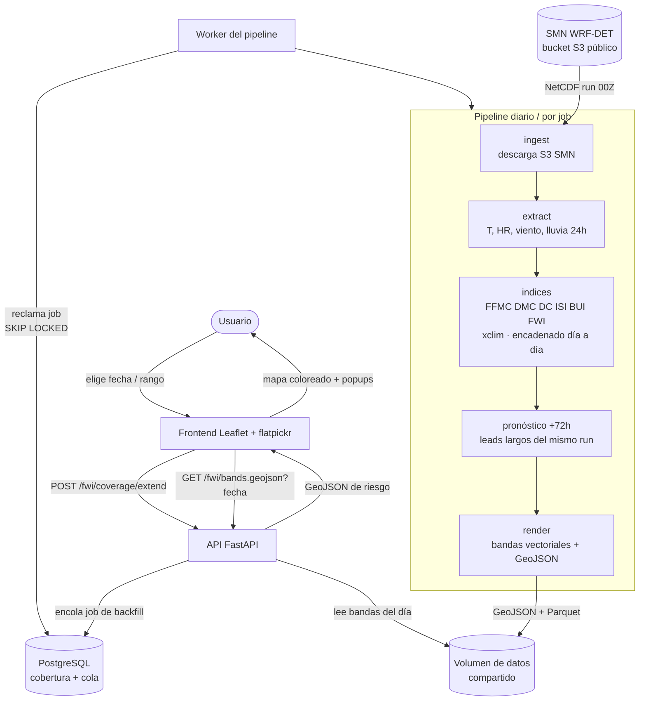
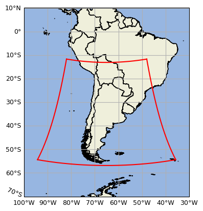
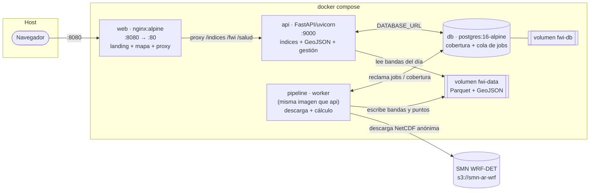
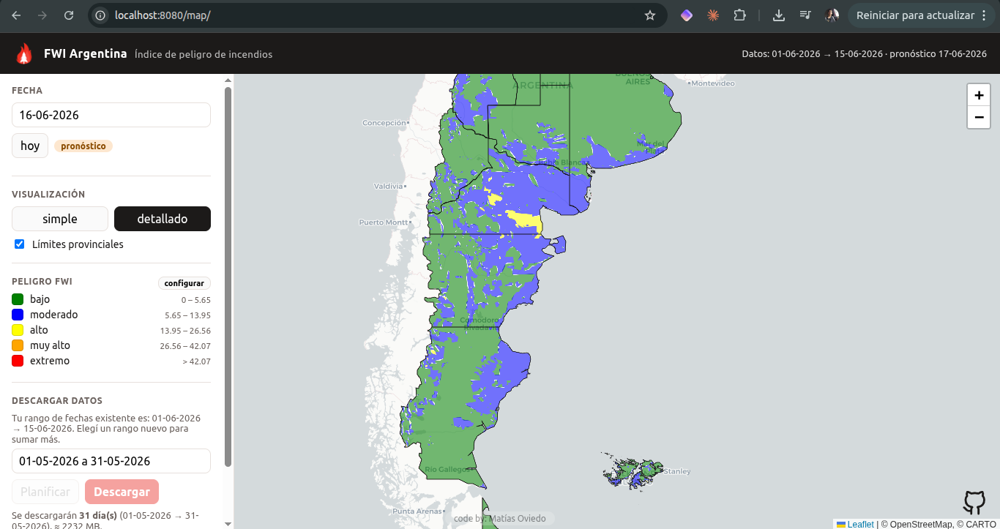
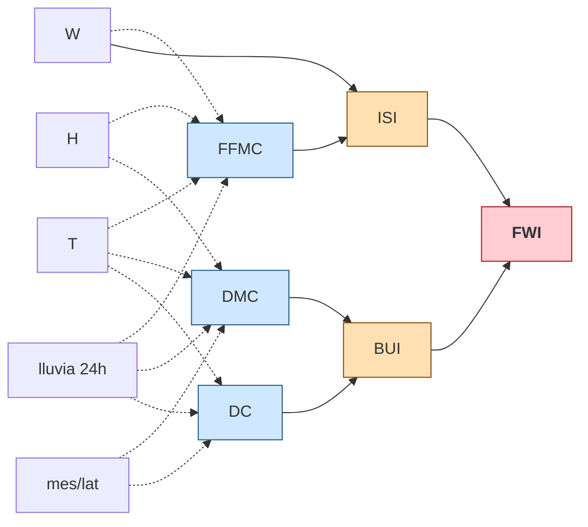

<div align="center">


# FWI Argentina

### Índice Meteorológico de Peligro de Incendios — Sistema Canadiense (CFFWIS) sobre todo el territorio argentino

Aplicación dockerizada que descarga el pronóstico del **Servicio Meteorológico Nacional (SMN)**,
calcula los seis componentes del **Fire Weather Index** sobre una grilla de ~4 km y los publica
como un mapa interactivo, con pronóstico encadenado a **+72 h**.

[](https://www.python.org/)
[](https://fastapi.tiangolo.com/)
[](https://www.postgresql.org/)
[](https://xclim.readthedocs.io/)
[](https://leafletjs.com/)
[](https://docs.docker.com/compose/)
[](https://github.com/matiasoviedo28/FWI)

</div>

---

## El problema

Argentina sufre incendios forestales todos los años. Anticipar **qué días y en qué
zonas** las condiciones meteorológicas favorecen la propagación del fuego permite planificar
patrullajes, posicionar recursos y emitir alertas antes de que el fuego se inicie.

El **FWI** es un valor adimensional que estima el **peligro meteorológico** de incendio combinando
cuatro variables: **temperatura, humedad relativa, viento y lluvia de las últimas 24 h**. No predice
*dónde* se va a iniciar un fuego ni *si* va a ocurrir: estima qué tan favorables están las
condiciones para que, una vez iniciado, se propague con intensidad.

Este proyecto toma el pronóstico numérico del SMN, lo procesa para toda Argentina y expone el
resultado en un mapa que cualquiera puede consultar por fecha, incluyendo el pronóstico a tres días.

---

## Cómo funciona

El usuario elige una fecha (o encola la descarga de un rango nuevo) desde el frontend. A partir de
ahí, el sistema descarga el pronóstico del SMN, lo procesa, calcula los seis índices del CFFWIS y
devuelve las bandas de riesgo que se pintan en el mapa.



### El pipeline paso a paso (`pipeline/`)

| # | Módulo | Qué hace |
|---|--------|----------|
| 1 | [`ingest`](pipeline/ingest.py) | Descarga los NetCDF del modelo **WRF-DET del SMN** desde el bucket público `s3://smn-ar-wrf/...` (acceso anónimo, sin credenciales). Por cada día baja dos archivos del run de las 00Z: las **instantáneas de mediodía** y la **precipitación acumulada 24 h**. Es idempotente: si el archivo ya está en cache, no lo vuelve a bajar. |
| 2 | [`grid`](pipeline/grid.py) | Genera la grilla de ~4 km (resolución nativa del WRF-DET) sobre el *bounding box* de Argentina y mapea cada punto a su celda del modelo con un **KDTree calculado una sola vez** y cacheado (la grilla del WRF es fija). |
| 3 | [`extract`](pipeline/extract.py) | Extrae de forma vectorizada temperatura (`T2`), humedad relativa (`HR2`, *clampeada* a 0–100 %), viento (`magViento10`, m/s→km/h) y precipitación (`PP`, mm acumulados) de todos los puntos, abriendo cada NetCDF una sola vez. |
| 4 | [`indices`](pipeline/indices.py) | Calcula FFMC, DMC, DC, ISI, BUI y FWI con [`xclim`](https://xclim.readthedocs.io/) (ecuaciones oficiales de Van Wagner, validadas contra el paquete `cffdrs` de R). Al recibir la **serie temporal completa**, `xclim` se encarga del **encadenamiento día a día** (DC y DMC son acumulativos) y de las **bandas de latitud del Hemisferio Sur**. |
| 5 | [`geo`](pipeline/geo.py) | Asigna provincia a cada celda por intersección espacial (`geopandas`). |
| 6 | [`render`](pipeline/render.py) | Agrupa las celdas contiguas del mismo nivel de riesgo en **bandas vectoriales** (isobandas) y exporta el GeoJSON del día (versión completa + simplificada) más un Parquet por celda para los popups. |

### El pronóstico a +72 h (honestamente)

> **No es un modelo de Machine Learning propio.** El pronóstico aprovecha que el mismo run del
> **WRF-DET del SMN** (modelo numérico determinístico) pronostica hasta **+72 h**. De un único run de
> las 00Z se extraen tres días:
>
> | Offset | Día | *Lead* instantáneas | *Lead* lluvia 24 h | Tipo |
> |:---:|:---:|:---:|:---:|:---|
> | 0 | hoy | +15 h (mediodía) | +24 h | observado |
> | 1 | +1 día | +39 h | +48 h | pronóstico |
> | 2 | +2 días | +63 h | +72 h | pronóstico |
>
> Los días de pronóstico se **encadenan al final de la serie observada** antes de calcular el CFFWIS
> (que es acumulativo), sin contaminar el histórico. El tope de +72 h es automático
> (`FORECAST_MAX_OFFSET = 2`): el frontend no permite elegir más allá de eso.

### Cobertura de datos del SMN

El sistema solo puede calcular el FWI **donde el modelo WRF-DET del SMN tiene datos**. Ese dominio —el
área que el modelo numérico cubre— es el polígono rojo de la figura: abarca Argentina y parte del cono
sur de Sudamérica. Fuera de ese límite no hay pronóstico disponible y, por lo tanto, no se calcula
índice.

<div align="center">
  
</div>

La grilla de muestreo del proyecto (~4 km) se recorta al territorio argentino dentro de ese dominio.
Qué **fechas** están disponibles depende, además, de qué días se hayan descargado: el run del SMN cubre
el día actual y hasta +72 h de pronóstico, y el histórico se va completando con el backfill desde el
mapa (panel «Descargar datos»).

---

## Arquitectura (servicios Docker)

Cuatro servicios definidos en [`docker-compose.yml`](docker-compose.yml). La **API** y el **pipeline**
comparten la misma imagen (cambia solo el comando) y un **volumen de datos**; el estado vive en
**PostgreSQL**; el **frontend** es nginx sirviendo estáticos y haciendo de *reverse proxy* a la API.



**Flujo de comunicación**

- El navegador solo habla con **`web`** (puerto `8080`). nginx sirve la landing y el mapa, y reenvía
  `/indices/`, `/fwi/` y `/salud` a **`api`** ([`deploy/nginx.conf`](deploy/nginx.conf)).
- **`api`** calcula índices puntuales, sirve las bandas GeoJSON del día y **encola** los jobs de
  descarga en Postgres.
- **`pipeline`** corre el worker ([`pipeline/worker.py`](pipeline/worker.py)): reclama jobs de la cola
  (`FOR UPDATE SKIP LOCKED`), descarga y procesa día a día, y cuando está ocioso asegura el día de hoy
  + pronóstico una vez por día.
- **`db`** es el *plano de control*: qué días están cubiertos (`coverage`) y la cola de descargas
  (`jobs`). Las grillas pesadas no van a la DB: viven como Parquet/GeoJSON en el volumen compartido.

---

## Escalabilidad

El diseño separa el **plano de control** (estado liviano en PostgreSQL) del **plano de datos** (grillas
pesadas en Parquet/GeoJSON sobre un volumen compartido), de modo que cada parte escala por separado:

- **Workers horizontales.** La cola de jobs usa `SELECT … FOR UPDATE SKIP LOCKED`, un patrón pensado
  para múltiples consumidores: se pueden levantar varias réplicas del servicio `pipeline` y reparten
  los jobs de descarga sin pisarse.
- **Extracción vectorizada.** Cada NetCDF se abre una sola vez y se indexan todos los puntos de la
  grilla de golpe; el mapeo punto→celda se calcula una única vez con un KDTree y queda cacheado.
- **Resolución configurable.** `FWI_GRID_KM` ajusta el tamaño de celda: subir el valor reduce la
  cantidad de puntos (y el costo de cómputo y de transferencia) sin tocar el código.
- **Salidas livianas.** El campo de FWI se publica como **bandas vectoriales** (~1 MB) en lugar de la
  nube completa de puntos (~50 MB), con compresión **gzip** en la API.
- **Persistencia particionada e idempotente.** El histórico meteorológico se guarda en **Parquet**, un
  archivo por fecha; reprocesar un día no duplica datos y permite backfills incrementales.
- **API y frontend sin estado.** Leen del volumen compartido y de Postgres, así que pueden replicarse
  detrás de un balanceador; nginx ya hace de *reverse proxy* hacia la API.

---

## Stack tecnológico

| Capa | Tecnología | Para qué |
|------|------------|----------|
| Lenguaje | **Python ≥ 3.10** | Todo el backend y el pipeline |
| API | **FastAPI** + **uvicorn** | Endpoints de índices, mapa y gestión |
| Índices de fuego | **xclim** (`indices.fire`) | CFFWIS validado contra `cffdrs` (R) |
| Datos científicos | **xarray · netCDF4 · numpy · pandas · scipy** | Lectura de NetCDF y cálculo vectorizado |
| Geoespacial | **geopandas · shapely · rasterio · pyarrow** | Grilla, provincias, bandas vectoriales, Parquet |
| Descarga | **s3fs** | Acceso anónimo al bucket S3 del SMN |
| Base de datos | **PostgreSQL 16** + **psycopg 3** | Cobertura de datos y cola de jobs |
| Frontend | **Leaflet · flatpickr** (HTML/JS/CSS) | Mapa interactivo y selector de fechas |
| Servidor web | **nginx** | Estáticos + *reverse proxy* a la API |
| Empaquetado | **Docker · docker compose** | Cuatro servicios, una imagen para api/pipeline |
| Calidad | **pytest · ruff** | Tests de regresión de los índices, *linting* |

Fuente de datos: modelo **WRF-DET** del SMN (`s3://smn-ar-wrf`, run 00Z, archivos `WRFDETAR_01H_*.nc`).
Variables consumidas: `T2` (°C), `HR2` (%), `magViento10` (m/s), `PP` (mm acumulados).

---

## Quickstart

### Requisitos

- **Docker** y **Docker Compose** (v2). Nada más: la imagen trae todas las dependencias.

### Levantar todo con Docker

```bash
git clone https://github.com/matiasoviedo28/FWI.git
cd FWI
docker compose up --build
```

Esto levanta los cuatro servicios. Una vez arriba:

| Servicio | URL | Qué es |
|----------|-----|--------|
| **Frontend** | <http://localhost:8080> | Landing del proyecto |
| **Mapa** | <http://localhost:8080/map/> | Mapa interactivo de peligro |
| **Healthcheck** | <http://localhost:8080/salud> | Estado de la API |

**Primer uso:** al arrancar no hay datos todavía. En el mapa, panel **«Descargar datos»**, elegí un
rango (o un solo día), hacé **Planificar** para previsualizar cuánto se va a bajar y luego
**Descargar**. El worker baja del SMN, calcula los índices y, al terminar, el mapa se actualiza solo.
El worker además asegura el día de hoy + pronóstico una vez por día de forma automática.

> 💡 **Cuantos más días previos descargues, más preciso es el resultado.** El DMC y el DC son
> **acumulativos**: arrancan en valores semilla (`6` y `15`) y necesitan varios días de historia
> contigua para "cargarse" y reflejar la sequía real. Si solo bajás un día suelto, ese día arranca
> casi de cero; si bajás varias semanas hacia atrás, el FWI de las fechas recientes queda mucho mejor
> calibrado (sobre todo el DC, que tiene memoria de semanas a meses). Por eso el backfill se mantiene
> **contiguo, sin huecos**: un hueco rompería el encadenamiento.

> El servicio `pipeline` corre el **worker** (cola de jobs + día actual). El archivo
> [`deploy/scheduler.sh`](deploy/scheduler.sh) es una alternativa de *scheduler* simple (cada 24 h)
> que no usa la cola; el `compose` por defecto usa el worker.

### Variables de entorno

| Variable | Default | Dónde |
|----------|---------|-------|
| `DATABASE_URL` | `postgresql://fwi:fwi@db:5432/fwi` | api · pipeline |
| `POSTGRES_USER` / `POSTGRES_PASSWORD` / `POSTGRES_DB` | `fwi` / `fwi` / `fwi` | db |
| `FWI_GRID_KM` | `4` | tamaño de cuadrante (km) |

> Las credenciales por defecto (`fwi`/`fwi`) son para desarrollo local; la base de datos no expone
> puerto al host. Para un despliegue real, sobreescribilas con tus propios valores.

### Local (desarrollo, sin Docker)

Requiere Python ≥ 3.10 y, en algunas distros, librerías geoespaciales del sistema
(`sudo apt install libgdal-dev libgeos-dev libproj-dev`) y un Postgres accesible.

```bash
python -m venv .venv && source .venv/bin/activate
pip install -e ".[dev]"

# Procesar el día de hoy (observado) + pronóstico +1/+2
python -m pipeline.run

# Backfill de un rango (observado, sin pronóstico)
python -m pipeline.run 2026-06-01 2026-06-13

# API
uvicorn api.main:app --reload --port 9000

# Tests de regresión de los índices
pytest -q
```

---

## La API

FastAPI. Los índices se calculan con el **mismo** `xclim` que el pipeline (una sola fuente de verdad).
Los endpoints se sirven a través de nginx bajo `/indices/` y `/fwi/`.

| Método y ruta | Qué hace |
|---|---|
| `POST /indices/{FFMC\|DMC\|DC}` | Calcula el código de humedad a partir del clima (modo `simple`/`complejo`, con mes y latitud) |
| `POST /indices/ISI/calc` · `BUI/calc` · `FWI/calc` | Calcula los índices a partir de los componentes previos |
| `GET /fwi/coverage` | Cobertura de datos (desde/hasta) y horizonte de pronóstico |
| `GET /fwi/bands.geojson?fecha=&kind=&simple=` | Bandas de FWI de una fecha (observado o pronóstico) |
| `GET /fwi/at?lat=&lon=&fecha=` | Datos de la celda más cercana (para el popup) |
| `GET /fwi/limites.geojson` | Límites interprovinciales |
| `POST /fwi/coverage/plan` · `extend` | Previsualiza / encola la descarga de un rango (contiguo) |
| `GET/PUT /fwi/escala` · `POST /fwi/escala/reset` | Consulta / edita los cortes de la escala de riesgo |
| `GET /fwi/jobs` · `GET /fwi/jobs/{id}` | Estado y progreso de los jobs de descarga |
| `GET /salud` | Healthcheck |

---

## Capturas

<div align="center">



</div>

---

## La matemática del FWI

El **Sistema Canadiense de Evaluación del Peligro de Incendios** (*Canadian Forest Fire Weather Index
System*, CFFWIS) modela la humedad de tres capas de combustible y la traduce en un índice de peligro.
Las ecuaciones son las de **Van Wagner & Pickett (1985)** y **Van Wagner (1987)**; en este proyecto se
ejecutan a través de `xclim` (`xclim.indices.fire._cffwis`), que las implementa con la convención del
paquete `cffdrs` de R y las **valida numéricamente** contra él.

> **Verificación.** Las ecuaciones de abajo se extrajeron de la implementación que efectivamente corre
> ([`pipeline/indices.py`](pipeline/indices.py) → `xclim`) y se cotejaron una a una con la referencia
> canónica (numeración *Eq.* de Van Wagner 1987). Donde el código sigue una convención específica de
> `cffdrs`/GFWED en lugar de la forma «de libro», se aclara explícitamente.

### Entradas (a mediodía local)

| Símbolo | Variable | Unidad | Fuente (WRF-DET) |
|:---:|---|:---:|---|
| $T$ | Temperatura del aire | °C | `T2` |
| $H$ | Humedad relativa | % | `HR2` (acotada a 0–100) |
| $W$ | Velocidad del viento | km/h | `magViento10` (×3.6) |
| $r_o$ | Lluvia de las últimas 24 h | mm | `PP` |
| — | Mes y latitud | — | ajustan DMC y DC (duración del día) |

Cada componente parte de su valor del día anterior; el sistema se inicializa con los valores estándar
$\text{FFMC}_0 = 85$, $\text{DMC}_0 = 6$, $\text{DC}_0 = 15$.

### Los seis componentes encadenados



**Tres códigos de humedad** (cuánta agua tiene cada estrato de combustible) + **dos índices
intermedios** (velocidad de propagación y combustible disponible) → **un índice final** (FWI).

---

#### 1 · FFMC — Fine Fuel Moisture Code

Humedad de la **hojarasca fina** (capa superficial, < 1 cm). Reacciona en **horas**; gobierna la
facilidad de ignición. Se trabaja sobre el contenido de humedad $m$ (no sobre el código directamente):

$$m_0 = \frac{147.2\,(101 - \text{FFMC}_0)}{59.5 + \text{FFMC}_0} \tag{Eq.1}$$

Si llovió ($r_o > 0.5$ mm) el combustible se humedece; si no, tiende a un **equilibrio higroscópico**
distinto según se esté secando ($E_d$) o humedeciendo ($E_w$):

$$E_d = 0.942\,H^{0.679} + 11\,e^{(H-100)/10} + 0.18\,(21.1 - T)\left(1 - e^{-0.115\,H}\right) \tag{Eq.4}$$

$$E_w = 0.618\,H^{0.753} + 10\,e^{(H-100)/10} + 0.18\,(21.1 - T)\left(1 - e^{-0.115\,H}\right) \tag{Eq.5}$$

La humedad evoluciona desde $m_0$ hacia ese equilibrio a una **tasa logarítmica** $k$ que depende de
$H$, $W$ y $T$ (Eq.6–9). Finalmente se vuelve a la escala del código:

$$\text{FFMC} = \frac{59.5\,(250 - m)}{147.2 + m} \tag{Eq.10}$$

donde $m$ es la humedad resultante. Más temperatura y viento, o menos humedad, ⇒ menos $m$ ⇒ **FFMC
más alto** (más peligro). Acotado a $[0, 101]$.

#### 2 · DMC — Duff Moisture Code

Humedad de la **capa orgánica media** (mantillo suelto, ~5–10 cm). Memoria de **días a semanas**.
El secado diario depende de la temperatura, la humedad y la **duración efectiva del día** $L_e$
(tabla por latitud y mes — Argentina usa la banda del Hemisferio Sur):

$$K = 1.894\,(T + 1.1)\,(100 - H)\,L_e \times 10^{-4} \tag{Eqs.16–17}$$

(con $K = 0$ si $T < -1.1$ °C). Si llovió ($r_o > 1.5$ mm), una rutina de humedecimiento (Eq.11–15)
reduce el código antes de sumar el secado. El nuevo valor es $\text{DMC} = \text{DMC}_{\text{lluvia}} + K$,
acotado a $\ge 0$. **Es acumulativo:** parte del valor del día anterior.

> *Nota de implementación:* en la Eq.12/15 `xclim` usa la forma de `cffdrs` (R/CFS),
> $w_{mi} = 20 + 280\,e^{-0.023\,\text{DMC}_0}$, no la variante de GFWED (Matlab). Ambas son
> equivalentes en intención; este proyecto sigue la de `cffdrs`.

#### 3 · DC — Drought Code

Humedad de la **capa orgánica profunda y compacta** (hasta ~20 cm). Memoria de **semanas a meses**;
indica sequía estacional y la dificultad de extinguir el fuego en profundidad. Su motor es una
**evapotranspiración potencial** $V$ que depende de la temperatura y de un **factor de duración del
día** $L_f$ (tabla por latitud/mes, Hemisferio Sur para Argentina):

$$V = 0.36\,(T + 2.8) + L_f, \qquad PE = \frac{\max(V,\,0)}{2} \tag{Eq.22}$$

Si llovió ($r_o > 2.8$ mm), la lluvia efectiva $r_d = 0.83\,r_o - 1.27$ recarga la humedad equivalente
$Q_0 = 800\,e^{-\text{DC}_0/400}$ y se recalcula un código tras la lluvia $\text{DC}_r$ (Eq.18–21).
El día cierra sumando el secado:

$$\text{DC} = \text{DC}_r + PE \quad (\text{con lluvia}), \qquad \text{DC} = \text{DC}_0 + PE \quad (\text{sin lluvia})$$

**Es acumulativo:** una sequía sostenida lo hace crecer monótonamente día tras día (es exactamente lo
que verifica el test [`test_dc_acumula_dia_a_dia`](tests/test_indices.py)).

---

#### 4 · ISI — Initial Spread Index

Combina la humedad de la hojarasca fina (vía FFMC) con el viento para estimar la **velocidad esperada
de propagación**. A partir de la humedad fina $m$ (misma Eq.1):

$$f(W) = e^{0.05039\,W} \tag{Eq.26}, \qquad f(F) = 91.9\,e^{-0.1386\,m}\left(1 + \frac{m^{5.31}}{4.93\times10^{7}}\right)$$

$$\boxed{\;\text{ISI} = 0.208\,\cdot f(W)\cdot f(F)\;} \tag{Eq.25–26}$$

> El factor **0.208** es esencial: sin él, el ISI se sobreestima ~4.8×. `xclim` lo absorbe en la
> constante ($0.208 \times 91.9 = 19.115$).

#### 5 · BUI — Build-Up Index

Combina DMC y DC para estimar el **combustible total disponible** para la combustión. Es una media
ponderada no lineal de las dos capas:

$$\text{BUI} = \frac{0.8\,\text{DMC}\cdot \text{DC}}{\text{DMC} + 0.4\,\text{DC}} \tag{Eq.27a}$$

cuando $\text{DMC} \le 0.4\,\text{DC}$; en caso contrario se usa la forma extendida (Eq.27b) que evita
que el BUI supere al DMC de manera espuria. Domina la **disponibilidad** de combustible (no la
velocidad).

---

#### 6 · FWI — Fire Weather Index

El índice final integra **propagación** (ISI) y **combustible disponible** (BUI). Primero una función
de combustible $f(D)$ según el BUI:

$$f(D) = 0.626\,\text{BUI}^{0.809} + 2 \quad (\text{BUI} \le 80) \tag{Eq.28a}$$

$$f(D) = \frac{1000}{25 + 108.64\,e^{-0.023\,\text{BUI}}} \quad (\text{BUI} > 80) \tag{Eq.28b}$$

$$B = 0.1\,\cdot \text{ISI}\cdot f(D) \tag{Eq.29}$$

y, para comprimir la cola alta a una escala manejable:

$$\boxed{\;\text{FWI} = \begin{cases} e^{\,2.72\,(0.434\,\ln B)^{0.647}} & B > 1 \\[4pt] B & B \le 1 \end{cases}\;} \tag{Eq.30}$$

El resultado es **adimensional** y sin límite superior fijo: valores típicos de calma rondan
0–5; condiciones extremas superan 40–50. La escala de riesgo de 5 niveles del proyecto usa por defecto
los cortes $[5.65,\ 13.95,\ 26.56,\ 42.07]$ (configurables por provincia desde el mapa).

---

### Ajustes por latitud y mes

Solo **DMC** (duración efectiva del día $L_e$) y **DC** (factor de duración $L_f$) dependen del mes y
la latitud. `xclim` selecciona la **banda del Hemisferio Sur** para latitudes negativas, lo que
desplaza el ciclo estacional medio año respecto del Hemisferio Norte: en Argentina, **enero (verano)
seca más que julio (invierno)**, como verifica el test
[`test_mes_y_hemisferio_influyen`](tests/test_indices.py). FFMC, ISI, BUI y FWI no dependen de la fecha.

> **Fuentes.** Van Wagner, C. E. & Pickett, T. L. (1985). *Equations and FORTRAN program for the
> Canadian Forest Fire Weather Index System.* Canadian Forestry Service, Forestry Technical Report 33. ·
> Van Wagner, C. E. (1987). *Development and structure of the Canadian Forest Fire Weather Index
> System.* Forestry Technical Report 35. · Implementación:
> [`xclim.indices.fire`](https://xclim.readthedocs.io/en/stable/api.html#fire-indices), validada contra
> el paquete [`cffdrs`](https://cran.r-project.org/package=cffdrs) (R).

---

## Estructura del repositorio

```
FWI/
├── pipeline/                 # job diario / por job de la cola
│   ├── ingest.py             # descarga S3 del SMN (instantáneas + lluvia 24h)
│   ├── grid.py               # grilla ~4 km + índice de celdas (KDTree, cacheado)
│   ├── extract.py            # extracción vectorizada de las 4 variables
│   ├── indices.py            # adaptador de xclim (CFFWIS) + wrappers para la API
│   ├── geo.py                # asignación de provincia (intersección espacial)
│   ├── render.py             # bandas vectoriales + GeoJSON + Parquet por celda
│   ├── storage.py            # I/O Parquet del histórico meteorológico
│   ├── db.py                 # Postgres: cobertura + cola de jobs
│   ├── run.py                # orquestador (observado + pronóstico)
│   └── worker.py             # consume la cola y mantiene el día actual
├── api/
│   ├── main.py               # app FastAPI (CORS + gzip)
│   ├── schemas.py            # modelos Pydantic
│   └── routers/              # indices · map · manage
├── web/
│   ├── index.html            # landing
│   ├── map/index.html        # mapa (Leaflet + flatpickr)
│   └── index_legacy.html · script.js   # dashboard estático adicional
├── shared/config.py          # configuración central (rutas relativas, SMN, escala)
├── data/
│   ├── CSV/                  # escalas de riesgo por provincia
│   └── JSON/                 # GeoJSON de límites y nombres de provincias
├── deploy/                   # nginx.conf · scheduler.sh
├── tests/                    # regresión de los índices
├── Dockerfile · docker-compose.yml · pyproject.toml
└── notebooks/EDA.ipynb
```

---

## Características

- **Datos oficiales del SMN**: descarga automática del modelo WRF-DET, con la estructura, las unidades
  y la semántica de la precipitación 24 h verificadas.
- **Índices validados**: FFMC, DMC, DC, ISI, BUI y FWI calculados con `xclim` (validado contra
  `cffdrs` de R), con **encadenamiento acumulativo día a día** de DC y DMC.
- **Extracción vectorizada** de las variables meteorológicas, con índice de celdas cacheado (KDTree).
- **Mapa de bandas vectoriales** rellenas: liviano y nítido a cualquier zoom.
- **Histórico por fecha + pronóstico a +72 h** (leads largos del mismo run del WRF-DET).
- **PostgreSQL** (cobertura + cola de jobs) y **gestión de descargas desde la web**: backfill contiguo
  disparado y seguido desde el mapa.
- **Arquitectura en servicios**: `db` + `pipeline/worker` + `api` + `web`, todo con Docker Compose.

---

## Descargo de responsabilidad

- `fwi.com.ar` es un proyecto independiente, **no** un medio de información
  oficial.
- Los resultados son una referencia complementaria, no una fuente única para decidir. Conviene
  contrastarlos con fuentes oficiales y otros modelos.

---

## Te puede interesar este repositorio

- [**dataset_estaciones_meteorologicas**](https://github.com/matiasoviedo28/dataset_estaciones_meteorologicas) —
  descargar datos de estaciones meteorológicas físicas para mayor precisión.

---

## Fuentes

- [Servicio Meteorológico Nacional (SMN)](https://www.smn.gob.ar/) — modelo WRF-DET (`s3://smn-ar-wrf`).
- [Canadian Wildland Fire Information System — FWI](https://cwfis.cfs.nrcan.gc.ca/background/summary/fwi).
- [Van Wagner (1987). *Development and structure of the CFFWIS* (TR-35)](https://cfs.nrcan.gc.ca/publications?id=19927).
- [`xclim` — Fire indices (CFFWIS)](https://xclim.readthedocs.io/) · [`cffdrs` (R)](https://cran.r-project.org/package=cffdrs).

---

## Autores

- **Desarrollo:** [Matías Oviedo](https://github.com/matiasoviedo28) — 👨‍🚒 Bombero Voluntario de Merlo, San Luis, Argentina.
- **Asesoría:** Alexis Lezcano — 👨‍🚒 Bombero Voluntario de Merlo, San Luis, Argentina.

## Apoyar el proyecto

[](https://cafecito.app/fwi)
